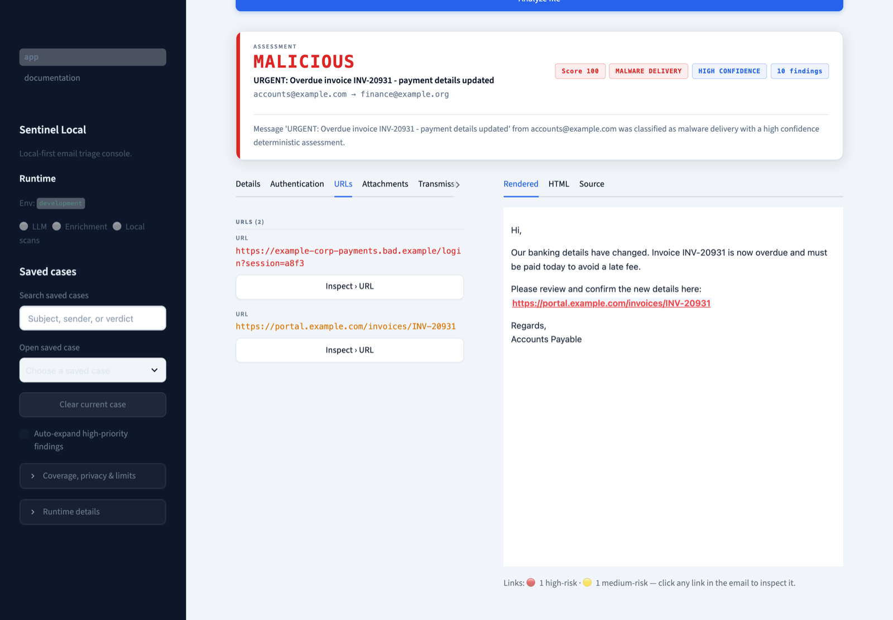

# Sentinel Local

Sentinel Local is a local-first suspicious email triage and investigation tool for macOS. It is designed for practical SOC analyst use with a cheap/free stack, local processing by default, optional privacy-conscious enrichment, and explainable outputs.



## Current capabilities

- Ingest `.eml`, `.msg`, `.txt`, or pasted raw content
- Parse headers, sender, recipients, body, and attachment metadata
- Preserve repeated headers like `Received` for mail-flow review
- Extract IOCs:
  - URLs
  - domains
  - IPs
  - email addresses
  - hashes found in content
- Perform deterministic analysis:
  - SPF / DKIM / DMARC result review if present
  - Reply-To and Return-Path mismatch detection
  - display-name impersonation heuristics
  - suspicious `Received` chain heuristics
  - phishing lure / urgency language
  - risky attachment metadata checks
  - analyst disposition mapping:
    - `benign`
    - `spam`
    - `phishing`
    - `malware_delivery`
    - `bec`
    - `needs_escalation`
- Structured header analysis:
  - normalized `Authentication-Results`
  - extracted `Message-ID`, `Return-Path`, `Reply-To`
  - originating IP collection
  - mail-flow hop timeline from `Received` headers
- Analyze URLs:
  - tracking-wrapper unwrapping
  - shortener detection
  - visible text vs destination mismatch
  - optional redirect resolution
  - hidden HTML artifact detection
- Analyze attachments:
  - risky extension flags
  - archive flags
  - macro-capable file flags
  - lure filename checks
  - MIME mismatch checks
  - local SHA-256 hashing during parsing
  - hash-first reputation support
- Optional local attachment scanning:
  - YARA
  - ClamAV via `clamscan`
- Optional enrichment:
  - VirusTotal
  - AbuseIPDB
- Optional local LLM narrative:
  - Ollama
  - LM Studio-compatible endpoints
- Save investigations locally in SQLite
- Export markdown, HTML, and JSON
- Always produce a deterministic analyst summary with recommended next actions

## Project layout

```text
sentinel-local/
├── REVIEW_AND_ROADMAP.md
├── pyproject.toml
├── start_sentinel.sh
├── src/sentinel_local/
│   ├── analyzers/
│   ├── api/
│   ├── app/
│   ├── attachment_analysis/
│   ├── core/
│   ├── domain/
│   ├── enrichers/
│   ├── extractors/
│   ├── llm/
│   ├── parsers/
│   ├── reports/
│   ├── storage/
│   ├── ui/
│   └── url_analysis/
└── tests/
```

## Requirements

- Python 3.11+
- macOS, Linux, or another Unix-like shell

## Setup

```bash
python3 -m venv .venv
source .venv/bin/activate
pip install --upgrade pip
pip install -e ".[dev]"
cp .env.example .env
```

## Run

Simplest path:

```bash
./start_sentinel.sh
```

Manual path:

```bash
source .venv/bin/activate
streamlit run src/sentinel_local/ui/app.py
```

Open:

- [http://localhost:8501](http://localhost:8501)

To try it, load [examples/demo_invoice_phish.eml](examples/demo_invoice_phish.eml), a synthetic invoice-fraud email that uses only reserved example domains.

Optional FastAPI health app:

```bash
uvicorn sentinel_local.api.main:app --reload
```

## Configuration

Core `.env` values:

```bash
SENTINEL_ENABLE_LLM=true
SENTINEL_LLM_PROVIDER=ollama
SENTINEL_OLLAMA_MODEL=qwen2.5:7b-instruct

SENTINEL_ENABLE_ENRICHMENT=true
SENTINEL_VIRUSTOTAL_API_KEY=...
SENTINEL_ABUSEIPDB_API_KEY=...
```

Optional URL screenshot settings:

```bash
SENTINEL_ENABLE_URL_SCREENSHOTS=false
SENTINEL_SCREENSHOT_PROVIDER=none
SENTINEL_SCREENSHOT_BASE_URL=
```

Optional local attachment scanning:

```bash
SENTINEL_ENABLE_ATTACHMENT_SCANNING=true
SENTINEL_YARA_BINARY_PATH=/opt/homebrew/bin/yara
SENTINEL_YARA_RULES_PATH=./rules/email_triage.yar
SENTINEL_CLAMSCAN_BINARY_PATH=/opt/homebrew/bin/clamscan
SENTINEL_ATTACHMENT_SCAN_TIMEOUT_SECONDS=20
```

If local scanners are enabled but binaries or rules are missing, Sentinel fails open and keeps the core analysis result.
The repo includes a starter ruleset at [rules/email_triage.yar](rules/email_triage.yar).

## Privacy and safety

- Local deterministic analysis is the source of truth.
- LLM output is explanatory only.
- Recipient emails and recipient domains are not externally enriched.
- Attachment reputation is hash-first where available.
- Local attachment scanners operate on transient temp files only; raw attachment content is not stored in SQLite.
- The project avoids public sandbox/file submission by default.

## Tests

```bash
pytest
```

## Recommended next steps

See [REVIEW_AND_ROADMAP.md](REVIEW_AND_ROADMAP.md) for the current review, workflow, gap analysis, and phased roadmap.

## Licence

MIT. See [LICENSE](LICENSE).
